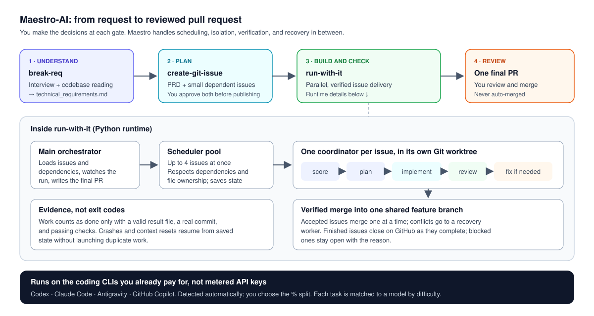
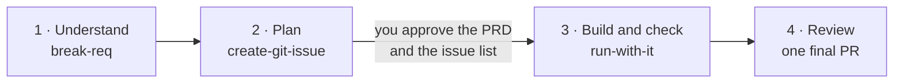
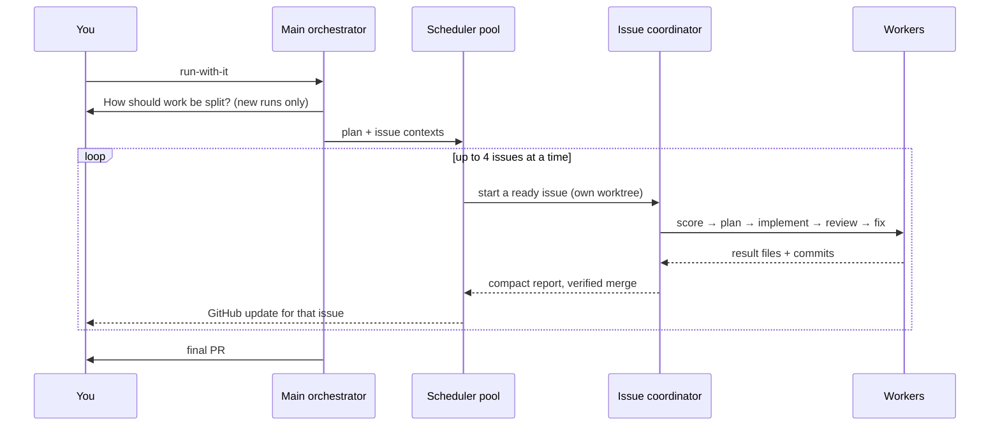

# Maestro-AI: a practical guide

From an idea to a reviewed pull request, using the coding agents you already have.



> [!TIP]
> New here? Read **[The usual path](#the-usual-path)** and **[Which skill do you need?](#which-skill-do-you-need)**, then follow **[Get started](#get-started)**. The [README](README.md) has the full technical reference.

**Contents:** [What Maestro-AI is](#what-maestro-ai-is) · [The usual path](#the-usual-path) · [Which skill do you need?](#which-skill-do-you-need) · [A real example](#follow-a-real-example) · [Who does what](#who-does-what-behind-the-scenes) · [How agents and models are chosen](#how-agents-and-models-are-chosen) · [Progress and recovery](#progress-failures-and-recovery) · [Settings](#settings-you-may-want-to-change) · [Paired design](#paired-design-with-pair-colleague) · [Get started](#get-started) · [Repository map](#find-your-way-around)

---

## What Maestro-AI is

Maestro-AI helps coding agents turn a request into small tasks, build and check each task, and combine the results into one pull request. **You decide what gets built. Maestro keeps track of everything else.**

| Part | What it is | What it does |
| --- | --- | --- |
| **Skills** | Seven instruction guides your coding agent follows | Each covers one job: requirements, issues, delivery, debugging, design discussion, test-first coding, short replies. Each has a clear stopping point. |
| **Runtime** | The `ai-skills` Python program (Windows, macOS, Linux) | Starts agents, schedules ready work, saves progress, checks results, and recovers interrupted work. |

### It runs on the subscriptions you already pay for

Maestro does **not** call paid model APIs itself. Every worker runs through a coding CLI you've installed and signed in to:

| Harness | CLI command | Notes |
| --- | --- | --- |
| Codex | `codex` | |
| Claude Code | `claude` | |
| Antigravity | `agy` | Runs the Gemini models and others from its own catalog |
| GitHub Copilot | `copilot` | With the current model list, only takes `quite-easy` and `easy` work |

When a new run starts, Maestro detects which of these are installed and asks **once** how to split the work between them:

```text
Found Codex, Claude Code, Antigravity, GitHub Copilot. How should work be split?
- (Recommended) Default: Antigravity 34% · Codex 34% · Claude Code 23% · GitHub Copilot 9%
- Custom split, e.g. codex=50, claude=30, agy=20   (0 leaves a CLI out)
```

The answer is saved for the whole run and reused on resume. → [How the split is applied](#1-which-harness-your-split)

---

## The usual path



| Step | Skill | You get | Stops before |
| --- | --- | --- | --- |
| 1. Make the request clear | `break-req` | Agreed decisions and ordered implementation steps in `technical_requirements.md` | Changing product code or creating issues |
| 2. Turn it into small tasks | `create-git-issue` | A PRD and small, dependency-ordered issues on GitHub (or `prd.md` + `issues.md` offline) | Publishing anything you haven't approved |
| 3. Build and check | `run-with-it` | Implemented, verified, reviewed changes merged into one feature branch, plus a final PR | Merging into your base branch: **the PR is never auto-merged** |

Start at the step you need. If your issues are already written, go straight to `run-with-it`.

---

## Which skill do you need?

Invoke a skill through your coding agent's skill mechanism. These are skill names, not shell commands.

| You say… | Skill | You get |
| --- | --- | --- |
| "Help me work out the details." | [`break-req`](skills/break-req/SKILL.md) | `technical_requirements.md`. It reads the codebase before asking you anything it can find out itself. |
| "Turn these requirements into issues." | [`create-git-issue`](skills/create-git-issue/SKILL.md) | A PRD and thin vertical-slice issues with `## Blocked by` dependencies. |
| "Work through the ready issues." | [`run-with-it`](skills/run-with-it/SKILL.md) | Verified changes, issue updates, and a final PR. Failures are reported, never counted as done. |
| "Find out why this is broken." | [`help-me-debug`](skills/help-me-debug/SKILL.md) | `debug_human_report.md` for you and `debug_llm_context.md`, a handoff another agent can implement from. Stops before fixing. |
| "Explore alternatives before we choose." | [`pair-colleague`](skills/pair-colleague/SKILL.md) | A bounded, read-only discussion between two AI colleagues and a `final-solution.md` decision record. |
| "Implement this with tests first." | [`tdd-implementation`](skills/tdd-implementation/SKILL.md) | Red → green → refactor, one behavior at a time, covering both success and failure paths. |
| "Keep the agent's replies short." | [`save-tokens`](skills/save-tokens/SKILL.md) | Compact narration; code, plans, issues, and PR text keep their normal format. |

---

## Follow a real example

> **Your request:** "Let users export their invoices as a CSV file."

1. **Agree on what "export" means.** `break-req` settles which fields go in the file, who can export, and whether filters apply. Everything goes into `technical_requirements.md`.
2. **Approve small, complete behaviors.** `create-git-issue` might propose: *basic export* → *respect active filters* → *empty-results message*. Each issue covers the app and its tests. You approve the PRD, then the breakdown.
3. **Pick the harness split.** `run-with-it` finds your installed CLIs and asks how to share the work (skipped if only one is installed, or if you set `HARNESS_SHARES`).
4. **Start only what's ready.** An issue waits until the issues it's blocked by are completed. Independent issues run in parallel; issues touching the same area are kept apart.
5. **Build each issue in its own workspace.** Every issue gets an isolated Git worktree. Workers score difficulty, plan if it's complex enough, implement test-first, and run the required checks.
6. **Review, fix, merge.** A reviewer approves or requests changes; fixes are checked again. Accepted work merges into one shared feature branch, and merge conflicts go to a recovery worker.
7. **Report and open the PR.** Finished issues get a GitHub comment and are closed as they complete; blocked ones stay open with the reason. The final PR comes from the shared branch for you to review.

---

## Who does what behind the scenes

Work is split up so no single agent has to remember every detail of every issue.



| Role | In plain words |
| --- | --- |
| **Main orchestrator** | The agent in your session. It prepares issues, dependencies, and context, watches progress, and writes the final report and PR. It never implements issues itself. |
| **Scheduler pool** | Starts issue coordinators, respects dependencies and file-ownership limits, refills free slots right away, saves outcomes, and posts per-issue GitHub updates. |
| **Issue coordinator** | Owns one issue end to end (called *Sub-Coordinator* in the source): difficulty scoring, model choice, planning, implementation, review, integration. |
| **Workers** | Each does one job: score, plan, implement, review, or revise. Recovery workers handle missing results and failed merges. |

> [!NOTE]
> A **worktree** is a separate Git working folder and branch. An **artifact** is a saved result file, such as a plan, review, or verification report. Both let the next agent continue from files instead of chat memory.

---

## How agents and models are chosen

Every worker gets a harness (CLI) and a model through one deterministic router, `ai-skills route`. It records every decision in `.run-with-it/usage-ledger.json`.

### 1. Which harness: your split

- Only harnesses with a share above 0% are used.
- Your split is the run's **overall usage target**. The registry's per-difficulty preferences are kept but shifted toward your split.
- It's a target, not a quota: a harness only gets work at difficulty levels where it has suitable models, and unavailable models are rerouted automatically.

### 2. How hard is the issue

A read-only scoring worker rates each issue from 1 to 5 on seven dimensions: *coupling / blast radius*, *pattern novelty*, *state & concurrency risk*, *data & rollback risk*, *verification risk*, *ambiguity of requirements*, and *scope size*. The total maps to a band:

| Total (7–35) | Band |
| --- | --- |
| 7–9 | `quite-easy` |
| 10–14 | `easy` |
| 15–19 | `medium` |
| 20–23 | `medium-hard` |
| 24–28 | `complex` |
| 29–35 | `extreme` |

One very risky dimension raises the floor: any **4** means at least `medium`, any **5** means at least `complex`.

### 3. Which model, by role

| Role | Band used | Why |
| --- | --- | --- |
| Implement / fix | The issue's band (refined by the plan, if one ran) | Match ability to the work |
| Review | One band higher | A weak reviewer misses real problems |
| Plan | Two bands higher | A vague plan makes every later step worse |

Planning only runs from `medium` upward by default (`RUN_WITH_IT_PLAN_MIN_COMPLEXITY`). The plan's own grounded difficulty score then routes implementation. The first reviewer of an issue stays its reviewer in later cycles, so it checks its own feedback instead of starting over.

Model lists, bands, and reasoning effort live in [`assets/agent-registry.json`](assets/agent-registry.json). How each CLI is launched lives in [`assets/agent-definitions.json`](assets/agent-definitions.json). This guide intentionally doesn't copy the model list, so it can't go stale.

---

## Progress, failures, and recovery

> [!IMPORTANT]
> **A process exiting successfully does not mark work done.** A result counts only with a valid result file, a real commit in the issue's worktree, and passing required checks. Unverified work is kept for recovery, never counted as success.

| Situation | What happens |
| --- | --- |
| Chat or terminal stops | Agents may still be running. On resume, the runtime checks saved process identities before starting anything, so work is never launched twice. |
| Context gets compacted | Coordinators re-read rules and state from disk, not from memory. |
| A model or CLI is unavailable | The route is excluded and work goes to another eligible model, within `MAX_AGENT_FALLBACKS`. |
| Tests fail or review rejects | Bounded fix-and-review cycles; then the issue is reported as failed with evidence. |
| Merge conflict | A merge-recovery worker resolves it on the shared branch. |
| Blocked dependency | Dependent issues wait, and the final report names the root blocker. |

**Where progress is saved**

| Path | What it tells you |
| --- | --- |
| `.run-with-it/main-state.json` | Overall plan, issue states, summaries, and final ledger |
| `.run-with-it/harness-plan.json` | The harness split you chose for this run |
| `.run-with-it/usage-ledger.json` | Every routing decision (harness, model, reason) |
| `.run-with-it/issues/<n>/report.json` | The compact result for one issue |
| `.run-with-it/issues/<n>/sub-state.json` | Where that issue's coordinator resumes |
| `.run-with-it/worktrees/` | Isolated workspaces for each issue |

Show a live per-issue board at any time with `ai-skills state status-board --state-file .run-with-it/main-state.json`.

---

## Settings you may want to change

| Setting | Default | What it changes |
| --- | --- | --- |
| `HARNESS_SHARES` | ask | Skip the split question: `default` or `codex=60,claude=40` |
| `PARALLEL_JOBS` | `4` | Maximum issues at once (`1` = one at a time) |
| `ISSUE_LABEL` / `ISSUE_LIMIT` | `ready-for-agent` / `1000` | Which issues are loaded |
| `RUN_WITH_IT_PLAN_ENABLED` / `RUN_WITH_IT_PLAN_MIN_COMPLEXITY` | `1` / `medium` | Turn planning off, or change when it runs |
| `SUB_COORD_AGENT` / `SUB_COORD_MODEL` | `codex` / `gpt-6.2-sol` | The issue coordinators (separate from the workers they route) |
| `FORCED_AGENT` / `FORCED_MODEL` | — | Force every worker onto one harness/model (still checked for compatibility) |
| `AGENT_REGISTRY_FILE` | — | Use your own model and routing registry |

The complete list is in the [`run-with-it` skill](skills/run-with-it/SKILL.md#inputs).

---

## Paired design with `pair-colleague`

For design decisions, not implementation. You pick both colleagues' harness, model, and reasoning effort. Each round, both read the same saved context, read-only. The coordinating agent records where they agree and disagree and picks the next focus.

- **3 to 8 rounds** by default. Both saying "ready" doesn't end it automatically; the coordinator judges whether the evidence is enough.
- Output: `final-solution.md`, with the chosen approach, rejected alternatives, risks, and open disagreements.

---

## Get started

**You need:** Python 3.12+, Git, at least one installed and signed-in coding CLI (Codex, Claude Code, Antigravity, or GitHub Copilot), and the GitHub CLI (`gh`) for issues and PRs.

**Recommended (no clone needed):**

With [`uv`](https://docs.astral.sh/uv/):

```text
uv tool install git+https://github.com/chanakya-net/Maestro-AI.git && maestro install
```

Or with [`pipx`](https://pipx.pypa.io/):

```text
pipx install git+https://github.com/chanakya-net/Maestro-AI.git && maestro install
```

<details>
<summary><strong>Manual install from a source checkout (macOS / Linux / Windows)</strong></summary>

**macOS / Linux:**

```text
git clone https://github.com/chanakya-net/Maestro-AI.git
cd Maestro-AI
python3.12 -m venv .venv
.venv/bin/python -m pip install .
.venv/bin/python -m ai_skills install --source . --dry-run
.venv/bin/python -m ai_skills install --source .
```

**Windows:**

```text
git clone https://github.com/chanakya-net/Maestro-AI.git
cd Maestro-AI
py -3.12 -m venv .venv
.venv\Scripts\python.exe -m pip install .
.venv\Scripts\python.exe -m ai_skills install --source . --dry-run
.venv\Scripts\python.exe -m ai_skills install --source .
```

</details>

Check the setup:

```text
maestro doctor --json
maestro harness detect
```

Then open your coding agent in the project you want to work on and invoke `break-req` (new idea), `help-me-debug` (something's broken), or `run-with-it` (issues are ready). The skills prepare all runtime files themselves.

> [!NOTE]
> The installer registers skills and packages the runtime. It doesn't install Python or coding CLIs, sign in to accounts, or broaden their permissions.

---

## Find your way around

| Where | What's there |
| --- | --- |
| [`skills/`](skills/) | The seven skill guides: what to do, when to stop, what to produce |
| [`src/ai_skills/`](src/ai_skills/) | The Python runtime: scheduling, dispatch, routing, harness detection, state, validation, Git, paired discussions |
| [`assets/`](assets/) | Worker prompts, coordinator rules, agent definitions, and model policy |
| [`tests/`](tests/) | Unit, integration, contract, and packaging tests using fake providers and temporary repositories |
| [`README.md`](README.md) | Full technical reference and command list |

Credits for adapted upstream skills are in the [README](README.md#credits). Licensed under [AGPL-3.0](LICENSE).
