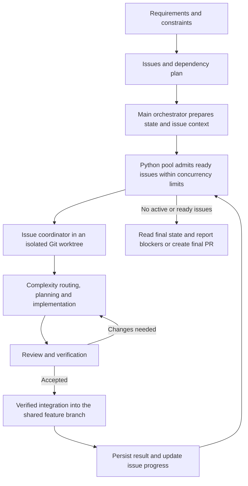

# Maestro-AI (AI-Skills)

Turn a software request into small tasks, tested changes, and a pull request.

Maestro-AI helps coding agents work through a project without losing track of the plan. You decide what should be built; the agents clarify the details, implement the work, check it, and report the result.

There are two parts:

- **Seven skills** guide the conversations and tasks: requirements, planning, coding, debugging, design discussions, and concise replies.
- **A Python runtime** starts agents, schedules ready work, saves progress, validates results, and helps recover interruptions. It uses the same commands on **Windows, macOS, and Linux**.

You bring your code repository and installed, authenticated coding agents. Their models and accounts provide the AI; Maestro-AI coordinates the work.

[Get started](#get-started) · [Choose a skill](#choose-a-skill) · [How a run works](#how-a-run-works) · [Technical reference](#technical-reference) · [Credits](#credits)

Prefer a visual walkthrough? Open [explainer.html](explainer.html).

## The usual workflow

| 1. Understand | 2. Plan | 3. Build and check |
| --- | --- | --- |
| `break-req` | `create-git-issue` | `run-with-it` |
| Agree on behavior, constraints, and unanswered questions. | Review a product requirements document (PRD), then approve small implementation issues. | Work through ready issues, verify changes, handle review, and prepare a final PR. |

Start with the stage you need. Prepared issues can go straight to `run-with-it`. Debugging and paired design are separate entry points; you do not need every skill for every task.

<a id="installation"></a>

## Get started

<a id="requirements"></a>

### What you need

- **Python 3.12 or newer** and **Git**.
- An installed, authenticated coding-agent CLI for execution, such as Codex, Claude Code, Agy, or OpenCode. Providers distributed through npm also need Node.js.
- The authenticated **GitHub CLI (`gh`)** for GitHub issues and PRs. Local planning and runtime diagnostics do not require GitHub access.

The registry controls supported models and availability. Copilot runtime selection remains disabled while its configured plan is exhausted. The installer registers skills and packages the runtime; it does not install Python, Node.js, or coding agents, sign in to their accounts, or broaden their permissions.

### 1. Get the repository

```text
git clone https://github.com/chanakya-net/Maestro-AI.git
cd Maestro-AI
```

### 2. Install the runtime and skills

Choose your operating system. The dry run previews what the skill installer will change.

<details>
<summary><strong>macOS / Linux</strong></summary>

Use an installed Python 3.12 or newer. If its command has a different name, substitute it below.

```text
python3.12 -m venv .venv
.venv/bin/python -m pip install .
.venv/bin/python -m ai_skills install --source . --dry-run
.venv/bin/python -m ai_skills install --source .
```

</details>

<details>
<summary><strong>Windows</strong></summary>

Use the Windows Python launcher and the environment's interpreter:

```text
py -3.12 -m venv .venv
.venv\Scripts\python.exe -m pip install .
.venv\Scripts\python.exe -m ai_skills install --source . --dry-run
.venv\Scripts\python.exe -m ai_skills install --source .
```

</details>

### 3. Check the setup

In that Python environment, run:

```text
python -m ai_skills doctor --json
python -m ai_skills agent list --detected-only
```

Here and below, `python` means the environment's interpreter. Activate the environment or use its full path from step 2. The installed `maestro` and `ai-skills` commands provide the same operations as `python -m ai_skills`. Activate this retained bootstrap environment, or use `.venv/bin/maestro` or `.venv/bin/ai-skills` on macOS/Linux, and `.venv\Scripts\maestro.exe` or `.venv\Scripts\ai-skills.exe` on Windows. Operational commands use a run pin first, then the active managed runtime. No arguments, help, version, doctor, install, and uninstall run locally; doctor reports the invoking environment.

`doctor` checks the interpreter and maintained resources. The agent list shows detected tools; use each provider's own sign-in process to establish account access.

### 4. Open your coding agent in the project you want to work on

Invoke a skill using your agent's normal skill mechanism. Start with `break-req` for a new idea, `help-me-debug` for a diagnosis, or `run-with-it` for prepared issues. These skill names are not shell commands.

The skills prepare the files and runtime configuration for you. The command reference below is for inspecting or configuring that work when you need more control.

<details>
<summary><strong>Installation options, protected files, and uninstall</strong></summary>

Installation packages the maintained prompts, registry, and all seven skills into an immutable runtime under `~/.ai-skill-collections/assets/runtimes/`. It publishes `runtime.json` only after verification. Use `--assets-dest PATH` to select another destination and `--only codex` (or another listed profile) to limit registrations. `install --list` lists profiles. A built wheel can replace `.` in `--source`.

**Existing installations:** To obtain `maestro` for the first time, start from a fresh official checkout containing this command (or use an appropriate wheel). Use the original separately owned bootstrap virtual environment, or create a new one with step 2 if it is absent. Do not install into a directory under `assets/runtimes/`. From the checkout, refresh the bootstrap package even if its version is unchanged:

```text
# macOS / Linux
.venv/bin/python -m pip install --upgrade --force-reinstall .
.venv/bin/python -m ai_skills install --source . --dry-run
.venv/bin/python -m ai_skills install --source .

# Windows
.venv\Scripts\python.exe -m pip install --upgrade --force-reinstall .
.venv\Scripts\python.exe -m ai_skills install --source . --dry-run
.venv\Scripts\python.exe -m ai_skills install --source .
```

Retain your chosen `--assets-dest` and `--only` options on both install commands. A managed runtime installation does not rewrite scripts in an older bootstrap environment or add directories to PATH. Activate the refreshed environment or use the full command paths above. The module form remains available for installation and recovery.

Existing unowned skill directories are protected. Inspect the dry-run output, then use `--replace-existing` to migrate an older installation explicitly; the installer preserves backups and records ownership. Registration uses local packaged content rather than fetching a changing branch.

Updates skip an already recorded source commit without changing the installation. Use `python -m ai_skills update --force` to refresh managed registrations at the same commit, with the usual ownership checks and backups. Existing immutable runtimes are verified and reused, preserving pinned runs. Missing legacy commit metadata is treated as unknown and triggers an update. `--dry-run --force` previews the refresh.

Preview an official update before applying it with `python -m ai_skills update --dry-run`. The JSON output includes the resolved main commit, selected integrations, any planned registration backup paths (backups of user-edited registrations include a timestamp chosen when the update applies, so preview shows `.edited-<UTC-timestamp>.` with `time_dependent: true` instead of an exact path), and whether the active runtime already matches. Preview downloads source into temporary storage, removes it afterward, and does not install a runtime or change registrations. Pass `--only <integration>` to preview an explicit selection; repeat the option to select multiple integrations.

**Update prerequisites and recovery:** Automatic updates require an owned active `runtime.json`; if the error says **install first**, use `ai-skills install --source <checkout-or-wheel>` from a separate bootstrap environment (see **Existing installations** above), or bootstrap a selected integration with `ai-skills update --only <integration>`. Updates also require Git on PATH, network access to github.com, and dependencies in the invoking runtime that satisfy the target requirements. Dependencies are pinned into the isolated candidate; updates never silently resolve new versions. Compatibility checks accept numeric release versions with `==`, `!=`, `>=`, `<=`, `>`, `<`, `~=`, comma-separated constraints and equality wildcards. Unsupported version or requirement syntax fails safely.

For an **unowned or invalid manifest**, back it up, inspect ownership, remove only the invalid manifest when appropriate, then reinstall; preserve existing runtime directories and registration backups. For **official source failed/timed out**, check Git, network access, and repository availability, then retry. Fetches are bounded and temporary checkouts are removed on success or failure. For an **incompatible dependency** or candidate **dependency check failed**, refresh the separately owned bootstrap environment from a fresh official checkout using **Existing installations**, then retry. Do not modify an immutable runtime under `assets/runtimes/`. These failures leave the active installation unchanged. If an earlier activation has **pending installation recovery**, a normal update attempts recovery first; preview cannot repair it. For **recovery incomplete**, inspect the reported journal and paths, restore access or missing originals, and retry before updating again. Recovery errors retain their recovery status instead of reporting an unchanged installation.

```text
python -m ai_skills uninstall --dry-run
python -m ai_skills uninstall
```

Uninstall removes owned registrations and restores preserved originals when safe. Edited or unrecognized content is preserved. Runtime versions are retained because other runs may still pin them; inspect the reported retained paths before any manual cleanup.

</details>

<a id="skills"></a>

## Choose a skill

| What you want to do | Skill | What you get |
| --- | --- | --- |
| Work out the details before coding | [`break-req`](skills/break-req/SKILL.md) | Decisions and implementation steps in `technical_requirements.md`. It stops before changing product code or creating issues. |
| Turn agreed requirements into issues | [`create-git-issue`](skills/create-git-issue/SKILL.md) | A PRD and small implementation issues with dependencies. You approve the PRD and issue breakdown before publication. Local fallback: `prd.md` and `issues.md`. |
| Work through ready issues | [`run-with-it`](skills/run-with-it/SKILL.md) | Implemented changes, verification results, GitHub progress updates, and a final PR. Failed or blocked work is reported. |
| Find out why something is broken | [`help-me-debug`](skills/help-me-debug/SKILL.md) | A human-readable `debug_human_report.md` and a detailed implementation handoff in `debug_llm_context.md`. It stops before applying a fix. |
| Explore alternatives before choosing | [`pair-colleague`](skills/pair-colleague/SKILL.md) | A bounded discussion between two AI colleagues and a `final-solution.md` decision document, including trade-offs and disagreements. |
| Implement assigned work with tests first | [`tdd-implementation`](skills/tdd-implementation/SKILL.md) | One behavior at a time: a failing test, enough code to pass, then refactoring with passing tests. Both positive and negative paths are covered. |
| Keep assistant replies short | [`save-tokens`](skills/save-tokens/SKILL.md) | Compact narration. Code, plans, issue bodies, PR descriptions, and saved workflow records keep their normal format. |

<details>
<summary><strong>Example: add invoice CSV export</strong></summary>

Imagine your request is: **“Let users export their invoices as a CSV file.”**

1. **Agree on the behavior.** `break-req` helps settle the fields, permissions, filters, and error cases. It explores the codebase before asking for facts it can find itself, and saves the agreed requirements.
2. **Approve small tasks.** `create-git-issue` proposes a basic export, then support for active filters and an empty-results message. Each issue covers its behavior across the app and tests. You review the PRD and the breakdown before publication.
3. **Run the prepared issues.** `run-with-it` starts work whose prerequisites are complete. Independent work can run together; overlapping work waits under the ownership rules.
4. **Build and check.** Workers implement each issue in its own Git workspace, run the required checks, commit changes, and address review feedback when needed.
5. **Combine accepted changes.** Issue branches merge into a shared feature branch. Merge problems go through recovery. Successful issues are updated and closed as they finish; failed or blocked issues stay open with an explanation.
6. **Review the final PR.** Once every issue has an outcome, the coordinating agent reports what finished and what could not proceed, and prepares the PR from the shared feature branch.

This example uses GitHub. When GitHub is unavailable, local planning and permitted local issue intake remain available; GitHub updates and PR creation still require access.

</details>

<a id="execution-flow"></a>

## How a run works

The main agent prepares the plan. A Python scheduler keeps ready issues moving. Each issue gets its own coordinator, which assigns implementation, review, and recovery work to workers.

| Role | In plain language |
| --- | --- |
| **Main orchestrator** | The agent in your main session. It prepares issues and context, watches the run, and produces the final report and PR. It does not implement issues itself. |
| **Python pool** | One scheduler starts ready issues, respects dependencies and ownership limits, fills freed slots, saves outcomes, and performs per-issue GitHub updates. |
| **Issue coordinator** | Called a *Sub-Coordinator* in the source. It owns one issue from scoring and model selection through implementation, review, integration, and a compact report. |
| **Workers** | Each does one job: score, plan, implement, review, or revise. Recovery workers handle missing or invalid reports and failed merges. |

A **worktree** is a separate Git working folder and branch. An **artifact** is a saved result file, such as a plan, review, or verification report. These let the next agent continue from files rather than relying on chat memory.

The default is up to **four issue coordinators** at once, subject to readiness and ownership rules. Coordinators also launch workers for their phases; four is the issue limit, not a total process limit. Use `PARALLEL_JOBS=1` for one issue at a time.

Only completed prerequisites release dependent issues. GitHub task dependencies come from `## Blocked by`; a parent PRD link is context, not a dependency. New plans use strict concurrency rules to keep overlapping work apart.

A final PR proposes accepted changes to the base branch. Creating it does not merge it. Successful issues are closed during the run; failed and blocked issues stay open with evidence.

<details>
<summary><strong>Detailed execution flow and architecture diagram</strong></summary>



1. The main orchestrator loads the issues, writes the dependency/concurrency plan, and prepares context for every pending executable issue. New plans use strict concurrency metadata so overlapping work does not run together.
2. One pool owns scheduling. It records each launch intent before dispatch, admits ready issues up to the configured limit, and fills freed slots as dependencies complete. Missing issue context must be supplied before that issue can launch.
3. Each issue coordinator routes its own workers through implementation, review, and bounded recovery. Coordinator model selection and worker model selection remain independent. Structured artifacts and Git evidence determine completion.
4. Accepted work goes through verified Git integration. Merge failures enter merge recovery; only completed dependencies unblock further work. The pool persists terminal reports and applies authorized GitHub progress updates.
5. The main orchestrator watches the pool, reads the final state, and prepares the final ledger and PR. A drained pool can still have blocked or unreachable issues, which must be reported.

</details>

<details>
<summary><strong>Paired design: two colleagues, one decision document</strong></summary>

Use `pair-colleague` separately when you want to compare solutions before implementing one.

You explicitly choose each colleague's agent, model, and reasoning effort. Both work read-only and receive the same saved context for each round. The coordinating agent reads both responses, records agreements and disagreements, and chooses the next focus.

Defaults are **at least 3 rounds and at most 8**. Matching “ready” responses do not end the discussion automatically: the coordinating agent decides whether the evidence is sufficient. It then writes `final-solution.md` with the selected approach, rejected alternatives, risks, and unresolved disagreements.

Runtime flow: `pair start` → `pair run-round` → coordinator assessment and `pair record-decision` → another round or `pair finalize`.

`pair status --run-dir PATH` reports the resume point. A busy round (exit 4) means wait and collect the existing attempt rather than launch another. See the [skill instructions](skills/pair-colleague/SKILL.md) for configuration and exact steps.

</details>

## Progress, failures, and recovery

Progress messages show the current stage and activity counts. Saved state records what is waiting, running, completed, or blocked.

**A successful process exit is not enough to mark work complete.** Managed results must pass validation, including required verification and Git evidence for implementation work. Unverified changes are preserved for recovery rather than counted as successful.

Existing agents can still be running after a chat or terminal stops. Resume using the saved run: the runtime checks process identities and results before starting replacements. Live or uncertain ownership prevents duplicate launches. An empty pool can still leave blocked or unreachable issues, so the final report must show what could not proceed.

<details>
<summary><strong>Saved files, resuming, and cleanup</strong></summary>

| Path | What it contains |
| --- | --- |
| `.run-with-it/main-state.json` | Overall plan, issue states, completed summaries, and final ledger. |
| `.run-with-it/issues/<n>/report.json` | A compact result for one issue, with verification and blockers. |
| `.run-with-it/issues/<n>/sub-state.json` | The issue coordinator's resume point and saved worker identities. |
| `.run-with-it/issues/<n>/workers/` | Plans, reviews, reports, state, and logs for individual attempts. |
| `.run-with-it/worktrees/` | Separate workspaces for issue implementation and integration. |
| `.pair-colleague/runs/` | Saved discussion rounds, coordinator decisions, and final decision documents. |

Restart with the same pool configuration or pair run directory so existing attempts can be reconciled. Do not reset running issues to pending just because the session ended.

Failed or interrupted runs retain state and worktrees. Before discarding a run, use the runtime's stop operation to confirm shutdown. Destructive cleanup needs authorization, and user-modified files are preserved. Exact cleanup rules live in [run-with-it](skills/run-with-it/SKILL.md).

</details>

## Technical reference

Expand the part you need. The [skill instructions](skills/) and maintained runtime code define exact behavior.

<a id="model-routing-configuration"></a>

### Model selection and configuration

Issues are scored for difficulty. The router uses the difficulty, worker role, eligible models, availability, and configured usage targets to choose an agent/model pair. Planning moves up two difficulty levels and review one, capped at the highest.

Model policy lives in [`assets/agent-registry.json`](assets/agent-registry.json). CLI launch settings live in [`assets/agent-definitions.json`](assets/agent-definitions.json). The issue coordinator's model and the worker models it routes are independent choices.

<details>
<summary><strong>Common execution settings</strong></summary>

| Setting | What it changes |
| --- | --- |
| `PARALLEL_JOBS` | Maximum active issues; default 4. Dependencies and ownership conflicts can reduce actual concurrency. |
| `ISSUE_LABEL` / `ISSUE_LIMIT` | Intake label and maximum issue count; defaults `ready-for-agent` and 1000. |
| `SUB_COORD_AGENT` / `SUB_COORD_MODEL` | Issue coordinator selection, separate from worker routing. |
| `FORCED_AGENT` / `FORCED_MODEL` | Explicit worker overrides, subject to compatibility and availability checks. |
| `AGENT_REGISTRY_FILE` | A custom model and routing registry. |

For the full list, see [run-with-it](skills/run-with-it/SKILL.md).

</details>

<details>
<summary><strong>Model catalog, eligibility, effort, and usage targets</strong></summary>

For model and routing updates, edit [`assets/agent-registry.json`](assets/agent-registry.json).
CLI commands, permissions, prompt transports, and agent aliases live separately in
[`assets/agent-definitions.json`](assets/agent-definitions.json). Its `defaults`
are shared by all agents; an agent's own values override them. Model support is
derived from the registry, so there is no second `known_models` list to maintain.

The bundled Claude lineup is limited to Opus 5.5 (`claude-opus-5-5`), Fable 5.1
(`claude-fable-5-1`), Sonnet 5.5 (`claude-sonnet-5-5`), and Haiku 5.5
(`claude-haiku-5-5`), using the IDs in [Anthropic's model documentation](https://platform.claude.com/docs/en/models/overview).
They run through the direct Claude CLI, whose default is Sonnet 5.5.

Codex supports only GPT-6.1 Sol (`gpt-6.1-sol`, the default), GPT-6 Astra
(`gpt-6-astra`), GPT-6.1 Terra (`gpt-6.1-terra`), and GPT-6 Luna (`gpt-6-luna`),
using the IDs in [OpenAI's model documentation](https://learn.chatgpt.com/docs/models#recommended-models).
Luna handles simple work and scoring, Terra medium work, Sol harder work, and
Astra the highest work tier. Older model entries retained for other agents do
not enable those models on Codex.

Each `model_catalog` entry groups a model's settings together:

```json
"gpt-6.1-sol": {
  "provider": "openai",
  "ability": "frontier",
  "complexity_weight": 7,
  "context_window": 1050000,
  "reasoning_effort": "high",
  "agents": ["codex"],
  "work_bands": ["medium-hard", "complex", "holy-fuck"],
  "effort_by_band": {"medium-hard": "high", "complex": "xhigh", "holy-fuck": "xhigh"}
}
```

This is an example of the main fields; the actual Sol entry also retains its
complexity-scoring restrictions and required-pool settings.

| Field | Purpose |
| --- | --- |
| Model entry key | Exact CLI model ID; it is passed unchanged to the agent. |
| `agents` | CLIs that support this ID. An empty list retains metadata without enabling execution. |
| `work_bands` | Automatic eligibility for implementation, modification, review, planning, and recovery, using the effective task band. Omit to keep it out of explicit worker band lists. |
| `complexity_weight` | Capability ranking used by scoring and as a selection tie breaker. |
| `context_window` | Context size used as a selection tie breaker. |
| `ability` | Descriptive capability label included in route decisions. |
| `reasoning_effort` | Default effort for direct runs and routes without a band-specific effort. |
| `effort_by_band` | Effort overrides at each effective task band. |
| `complexity_bands` | Optional exact bands for the worker that **scores** task complexity, separate from the workers doing the task. Otherwise scoring uses the existing weight/minimum-band rules. |
| `min_band` | Minimum scoring band when `complexity_bands` is absent; it does not override explicit `work_bands`. |
| `exclude_from_complexity` | Prevents normal selection as the complexity-scoring worker. |
| `required_bands` | Adds the model to complexity-scoring candidate pools at these bands, subject to existing restrictions; selection is still balanced. |
| `alias_of` | Reuses another model's metadata for a different CLI ID. Declare its own `agents`, `work_bands`, and `required_bands`; these memberships are not inherited. |

Direct Claude and Codex runs apply one effort policy by canonical harness
(aliases such as `codex-cli` and `claude-code` resolve first) and the run's
actual role. Task difficulty and model provider never change it.

| Harness | Non-planning role | `plan` role |
| --- | --- | --- |
| Codex | Every recognized effort becomes `high` | Every recognized effort becomes `xhigh` |
| Claude | `low`/`medium`/`high` kept; `xhigh`, `max`, `maximum` become `high`; unset becomes `high` | `low`/`medium`/`high`/`xhigh` kept; `max`, `maximum` become `xhigh`; unset becomes `xhigh` |

Accepted legacy tokens are `low`, `medium`, `high`, `xhigh`, `max`, and
`maximum`; any other value fails before launch. Neither `max` nor `maximum` is
sent to Claude or Codex. When normalization changes an explicit request, the
effective value is used in argv and dry-run output, and the original is kept as
`requested_effort`. AGY and other harnesses are unchanged.

Standalone planning requires an explicit role, for example:

```sh
ai-skills agent run --agent codex --role plan --context-file context.md --unattended --dry-run
```

This previews Codex effort `xhigh`; omitting `--role plan` uses `high` even
if `RUN_WITH_IT_ROLE=plan` is inherited or the prompt asks for a plan. An
explicit non-planning role takes precedence over the inherited role. Other
inherited worker roles retain their existing artifact behavior. Structured API
and dispatcher configurations can still explicitly set the `plan` role.

To add a model, add one entry with its supported agents and desired bands. To
change effort, edit that entry's `effort_by_band`. To change usage percentages,
edit `model_routing.usage_distribution`:

- `default_target_percent` sets the global usage target.
- `non_complexity_band_target_percent` sets worker targets by effective band.
  `default` covers bands without an override.
- `role_band_target_percent.complexity` sets scoring-worker targets with the same
  default/override convention.
- `role_agent_preference.default` sets the tie-breaking order; individual roles
  can override it.
- `role_target_percent` retains legacy role summaries in route output and the
  scoring fallback policy. Worker selection uses the **band** targets above.

Automatic non-scoring work uses AGY Flash Low (`gemini-3.8-flash-low`) at the
effective `quite-easy` band and Flash Medium (`gemini-3.8-flash-medium`) at
`easy`. These are the only AGY worker models admitted automatically at those
bands; AGY has no automatic worker at medium or harder bands. Review raises the
effective band by one and planning by two, capped at the highest. Both Flash
worker entries are excluded from complexity scoring, whose existing model
policy remains unchanged. Existing usage targets and older direct model
memberships remain unchanged. Explicit agent/model overrides retain compatibility
and availability checks and may select a model outside automatic band lists.

`selection_strategy: "usage-share-debt"` describes the existing deterministic
algorithm. The router ranks eligible agent/model pairs by global and role usage
deficits and projected share error, then agent preference, distance from the target
weight, context size, and stable model/agent IDs. An eligible sticky reviewer
preference can retain the previous model. It does not randomly choose a pool or
compare prices. The strategy is fixed in Python; unsupported strategy names are
rejected in version 2 registries.

Validate edits with `python -m ai_skills doctor --json`. For a custom version 2
registry, keep its referenced definitions JSON beside it and set
`AGENT_REGISTRY_FILE` to the registry path. Existing self-contained version 1
registries remain supported. Python consumers should call
`ai_skills.registry.load_registry(path)` to expand defaults, aliases, and model
memberships into the runner/router's self-contained version 1 data structure.
The expanded result can also be saved as a standalone registry override.

</details>

<a id="runtime-commands"></a>

### Runtime operations

<details>
<summary><strong>CLI commands, pool configuration, watching, and stopping</strong></summary>

| Command | Responsibility |
| --- | --- |
| `agent run`, `agent list`, `agent models` | Provider invocation, detection, and model discovery. |
| `worker dispatch`, `worker inspect`, `worker emit` | Durable worker execution, inspection, and structured status events. |
| `run pool`, `run watch`, `run inspect`, `run stop` | Dependency scheduling, event observation, worker inspection, and owned process shutdown. |
| `state` | Transactional issue and coordinator state operations. |
| `route` | Registry-driven model selection and budget policy. |
| `artifact` | Validate and recover role-specific artifacts against Git evidence. |
| `git prepare-issue`, `git merge-issue` | Prepare resumable issue worktrees and verify disposable integration worktrees. |
| `github update` | Apply authorized issue progress updates through `gh`. |
| `report pr` | Render the final PR description from persisted results. |
| `pair` | Start, continue, inspect, and finalize a paired discussion. |

Use `python -m ai_skills COMMAND --help` for exact arguments. There is no shell selection or PowerShell parameter variant.

Workers accept JSON configuration through `worker dispatch --config PATH`. Pools accept a versioned configuration through `run pool --config PATH`; pool configuration records use `schema_version: 1`. JSON booleans must be `true` or `false`, rather than strings such as `"false"`.

The [run-with-it skill](skills/run-with-it/SKILL.md) creates the main state and issue context files before launching the pool. After that preparation, a minimal `.run-with-it/pool.json` is:

```json
{
  "schema_version": 1,
  "state_file": "/absolute/run/.run-with-it/main-state.json",
  "run_root": "/absolute/run",
  "parallel_jobs": 4,
  "sub_coord_agent": "codex",
  "sub_coord_model": "gpt-6.1-sol",
  "detach": true
}
```

Replace the paths with absolute paths for your system, including a drive letter on Windows, and choose an installed, authenticated coordinator provider/model. Windows paths in JSON can use forward slashes, such as `C:/work/project`. Keep generated configuration under the ignored `.run-with-it/` directory. Run the following commands from the run root. With `detach: true`, launch returns after startup so the same terminal can watch; the default is foreground execution.

```text
python -m ai_skills run pool --config .run-with-it/pool.json --validate-only
python -m ai_skills run pool --config .run-with-it/pool.json
python -m ai_skills run watch --events-log .run-with-it/status/events.log --pool-state-file .run-with-it/main/pool.state.json --wait-seconds 30
python -m ai_skills state status-board --state-file .run-with-it/main-state.json
```

Validation checks the prepared configuration/state without launching issue workers. It can write runtime state and the engine pin; use it in the intended run directory.

| Watch result | Next action |
| --- | --- |
| `running` (exit 0) | Watch again. The window ended or buffered events remain to be delivered. |
| `pool-empty` (exit 0) | Read the main state and status board for completed work, blockers, or unreachable dependencies. |
| `pool-dead` (exit 3) | Inspect the persisted state and re-enter with the same pool config for ownership reconciliation. Unknown ownership can still block admission. |

Repeat watch calls until `pool-empty` so final buffered events are included. Completion belongs to the current pool identity: restarting a drained pool with requeued work does not reuse the previous pool's terminal cursor state.

To stop a run when authorized:

```text
python -m ai_skills run stop --run-root . --term-wait-seconds 1
```

The stop command first requests that pool admission halt, then verifies and stops owned processes. Pool scheduling sleeps check stop requests at intervals of at most one second. `STOP|state=dead` (exit 0) confirms shutdown; `STOP|state=unknown` (exit 3) requires preserving state and investigating ownership or surviving processes before cleanup. The termination grace period does not bound the whole shutdown operation.

`git merge-issue` accepts `--verification-file` containing a JSON list of argument lists, for example `[["python", "-m", "pytest", "-q"]]`. Commands run without a shell. Supply the project's actual verification commands; the default Git whitespace check alone does not establish project correctness. Pushing requires explicit `--push`.

Provider selection follows explicit configuration, environment overrides, then registry defaults. `SUB_COORD_AGENT`/`SUB_COORD_MODEL` select coordinator execution; `FORCED_AGENT`/`FORCED_MODEL` constrain worker routing independently. Deprecated ambient `AGENT`/`MODEL` aliases remain available for direct agent execution, while dispatchers clear them before launching providers. Credentials are inherited at execution time and are not serialized into runtime records.

</details>

<details>
<summary><strong>Provider prompt transport and AGY compatibility</strong></summary>

Maintained providers receive full prompts through stdin, avoiding operating-system command-line length limits. CLI text input and output use UTF-8 on every platform. AGY receives the selected model ID unchanged through `--model`, including partner-model IDs and their effort suffixes. AGY requires a current CLI supporting `--input-format` and `--output-format`; the runtime checks these flags before launching a paid attempt and reports an upgrade instruction for older builds. Its [documented streaming protocol](https://antigravity.google/docs/cli/headless/#stream-prompts-from-stdin) is decoded back into the normal response text while retaining raw output for recovery. Custom registries retain argv input by default; set `invocation.prompt_transport` to `stdin` for a provider that supports plain stdin.

</details>

<details>
<summary id="managed-attempt-reporting"><strong>Managed attempt reporting and validated outcomes</strong></summary>

Dispatcher-managed workers receive one packaged `artifact-protocol.md` appended to their role prompt with authoritative run/attempt IDs and named absolute output paths. Every terminal attempt publishes a report at its usual primary result path: verified success uses the existing role schema; failed, blocked, or orderly interrupted work uses `schema_version=1`, `artifact_kind="role_failure"`, exact `run_id`, `attempt_id`, `issue`, `role`, terminal `status`, and nonempty `reason` and `summary`. Optional verification/evidence records describe actual commands and errors. Failure publication needs no commit, review instructions, or plan Markdown; it must never claim passing verification. Use the existing `ai-skills artifact write-json` command for both paths. A failed test is a reason to publish a failure report, not to omit it. Success still requires the existing commit/Git proof or verified no-op, passing required verification, and role companions.

Before any wrapper or provider launch, the dispatcher persists the exclusive attempt claim, configuration, and pending outcome; a storage failure prevents launch. Timeout/interruption intent is durably recorded before signaling the owned tree. The provider return code describes only its process. After proving owned-tree shutdown and durable exit status, the dispatcher validates the artifact and publishes the runtime-owned `<state_file>.outcome.json`, terminal state, then DONE, in that order. The versioned outcome binds identity and paths and records pending/success/failed/blocked/interrupted, both provider and worker return codes, timestamps, reason, failure class, and optional `issue_outcome`. Workers never write this sidecar or managed DONE. Standalone `agent run` and paired discussions retain their existing process-facing API and collection behavior.

A Sub-Coordinator's valid `blocked`, `failed-review`, `merge_failed`, or `failed-merge` report is a successful **report handoff**: dispatcher completed/0, sidecar success with separate `issue_outcome`, and DONE scope `role-handoff`. The pool consumes that bound validated outcome and applies issue policy: only completed issues satisfy dependencies; merge failures enter existing merge recovery. A typed role failure means the report handoff failed and follows bounded recovery. Availability failures keep their separate route-exclusion policy. Raw process success, chat, log messages, and premature DONE cannot advance a phase. Rejected provider bytes stay at their attempt-bound primary path while the attempt is current. For rejected handoffs, pool-generated blocked policy reports use `<state_file>.policy-report.json`; issue state, summaries and GitHub updates may refer to that separate report without changing the worker artifact/outcome binding. A replacement intent is persisted before shared prior outputs are quarantined for retry.

Unknown process ownership or missing exit evidence leaves the attempt nonterminal and prohibits duplicate launch. Adoption rechecks identity, report evidence and the outcome journal after proven shutdown, then repairs interrupted publication without relaunching. The outcome/state/DONE writes are ordered, not a transaction: a crash can leave later files missing, and storage failure may prevent even a terminal outcome from being recorded. Claims remain for reconciliation; corrupt/conflicting journals fail closed. Abrupt process termination may prevent the provider from publishing a failure report, so the runtime records the evidence it can prove rather than fabricating successful work.

</details>

<details>
<summary id="recovery-and-upgrades"><strong>Runtime versions, process ownership, and recovery details</strong></summary>

A pool records its Python engine and interpreter in `.run-with-it/engine.json`; pair runs pin their engine in `config.json`. Commands select that interpreter before parsing version-specific arguments. Installing a newer default does not move an existing run to another runtime. Missing or incompatible pinned runtimes fail explicitly.

Only a JSON object explicitly containing `engine_runtime` is treated as a pair runtime pin. Other valid project `config.json` values do not select a pair runtime; malformed JSON or an invalid explicit pin still reports an error.

Finish or stop legacy runs before migrating. Active legacy state is refused rather than adopted into an incompatible engine. The Python runtime preserves existing state schema contracts and supports guarded imports of quiescent pair runs. Historical design documents describe earlier implementations; executable instructions in `skills/` and this README describe the current runtime.

Worker silence is measured from captured provider stdout/stderr, separately from wrapper heartbeats. Defaults report `quiet` after 120 seconds and `stalled` with `stall_reason=alive-but-silent` after 600 seconds; new output returns the worker to `running`. These are diagnostic states: silence alone does not terminate a live worker. Configure explicit `timeout_seconds` and `hard_limit_seconds` for execution limits. Preserved but unverified work enters artifact recovery instead of being accepted as success.

Restart with the same pool configuration or pair run directory to reconcile existing attempts. Live or uncertain ownership prevents a replacement launch, including when provider startup metadata is still being published. Detached worker startup allows for capability checks and the ownership handshake in addition to its configured bootstrap interval. Preserve run state, process records, logs, and worktrees until recovery or confirmed shutdown is complete.

State updates use atomic replacement and ownership-aware directory locks. Process records include creation identity, allowing a restarted controller to distinguish owned workers from recycled PIDs. On POSIX the runtime owns a process session; deliberately detached descendants that create a new session can escape that boundary. On Windows, suspended launch into a kill-on-close Job Object prevents the normal child-launch race. Consoleless Windows shutdown terminates the owned job. Use a local filesystem supporting atomic creation and rename for runtime state.

</details>

## Repository map

| Where | What belongs there |
| --- | --- |
| [`skills/`](skills/) | The seven skill guides: scope, workflow, boundaries, and outputs. |
| [`src/ai_skills/`](src/ai_skills/) | Python installation, scheduling, dispatch, routing, state, result validation, Git integration, and paired discussions. |
| [`assets/`](assets/) | Worker prompts, coordinator rules, agent definitions, model policy, and the shared result-reporting protocol. |
| [`tests/`](tests/) | Unit, integration, contract, and packaging checks using fixture providers and temporary repositories. |
| [`pyproject.toml`](pyproject.toml) | Dependencies, the CLI entry point, and packaged resources. |
| [`.github/workflows/test.yml`](.github/workflows/test.yml) | Native test matrix for Windows, macOS, and Linux with Python 3.12 and 3.15. |

The maintained runtime is Python on all three operating systems. Earlier Bash and PowerShell launch recipes are historical. Generated logs, run state, and virtual environments are not maintained source.

## Development

<details>
<summary><strong>Run tests and build the package</strong></summary>

```text
python -m pip install -e ".[dev]"
python -m pytest -q
python -m build
```

CI runs the native Python suite on Windows, macOS, and Linux with Python 3.12 and 3.15. Tests use fixture providers and temporary repositories, including process recovery, scheduling, artifact policy, installation, and wheel resources. Provider credentials and paid requests are unnecessary for the suite. Live provider authentication and interactive registration remain environment-specific checks.

</details>

## Credits

The following skills contain closely matching material adapted from upstream sources. Each skill's Credits section links the compared version and identifies Maestro-AI's additions.

| Maestro-AI skill | Upstream source |
| --- | --- |
| [`break-req`](skills/break-req/SKILL.md#credits) | Matt Pocock's `grill-me` in [mattpocock/skills](https://github.com/mattpocock/skills). |
| [`create-git-issue`](skills/create-git-issue/SKILL.md#credits) | Matt Pocock's `to-prd`, `to-issues`, and `triage` in [mattpocock/skills](https://github.com/mattpocock/skills). |
| [`tdd-implementation`](skills/tdd-implementation/SKILL.md#credits) | Matt Pocock's `tdd` in [mattpocock/skills](https://github.com/mattpocock/skills). |
| [`save-tokens`](skills/save-tokens/SKILL.md#credits) | Julius Brussee's `caveman` in [JuliusBrussee/caveman](https://github.com/JuliusBrussee/caveman). |

## License

See [LICENSE](LICENSE) for the repository's AGPL-3.0 license. Upstream credit and source links are recorded in the adapted skill files.
