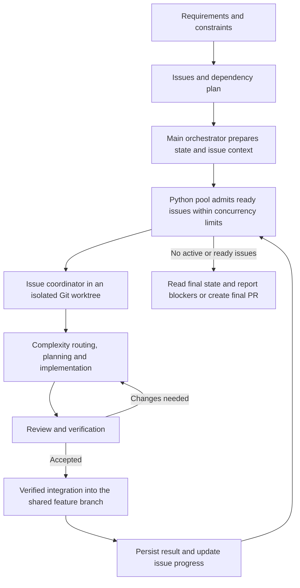

# AI-Skills

AI-Skills coordinates coding agents through dependency-aware issue scheduling, isolated Git worktrees, model routing, review loops, artifact recovery, and merge recovery. Seven skills guide requirements discovery, issue creation, implementation, debugging, and paired design discussions.

The maintained runtime is Python on Windows, macOS, and Linux. The same commands and JSON configuration replace the former Bash and PowerShell entry points.

## Requirements

- Python 3.12 or newer and Git.
- A supported coding agent CLI for execution: Codex, Claude Code, Gemini/Antigravity, Agy, or OpenCode. Install and authenticate the providers you intend to use. A provider distributed through npm still requires Node.js.
- Authenticated GitHub CLI (`gh`) for GitHub issue and PR operations. Local planning and runtime diagnostics do not require GitHub access.

The registry defines supported models and availability. Copilot runtime selection remains disabled while its configured plan is exhausted. The installer does not install Python, Node.js, or providers, and does not broaden their permissions.

Maintained providers receive full prompts through stdin, avoiding operating-system command-line length limits. CLI text input and output use UTF-8 on every platform. AGY requires a current CLI supporting `--input-format` and `--output-format`; the runtime checks these flags before launching a paid attempt and reports an upgrade instruction for older builds. Its [documented streaming protocol](https://antigravity.google/docs/cli/headless/#stream-prompts-from-stdin) is decoded back into the normal response text while retaining raw output for recovery. Custom registries retain argv input by default; set `invocation.prompt_transport` to `stdin` for a provider that supports plain stdin.

## Installation

Clone this repository and create a Python environment. On macOS/Linux, select an installed Python 3.12 or newer:

```text
python3.12 -m venv .venv
.venv/bin/python -m pip install .
.venv/bin/python -m ai_skills install --source . --dry-run
.venv/bin/python -m ai_skills install --source .
```

On Windows, bootstrap with the Python launcher and use the environment's interpreter:

```text
py -3.12 -m venv .venv
.venv\Scripts\python.exe -m pip install .
.venv\Scripts\python.exe -m ai_skills install --source . --dry-run
.venv\Scripts\python.exe -m ai_skills install --source .
```

The examples below use `python` to mean that environment's interpreter. Activate the environment or substitute its full interpreter path from above; every runtime command then has the same arguments on all three systems. `python -m ai_skills` and the installed `ai-skills` console command are equivalent.

Installation packages the maintained prompts, registry, and all seven skills into an immutable runtime under `~/.ai-skill-collections/assets/runtimes/`. It publishes `runtime.json` only after verification. Use `--assets-dest PATH` to select another destination and `--only codex` (or another listed profile) to limit registrations. `install --list` lists profiles. A built wheel can replace `.` in `--source`.

Existing unowned skill directories are protected. Inspect the dry-run output, then use `--replace-existing` to migrate an older installation explicitly; the installer preserves backups and records ownership. Registration uses local packaged content rather than fetching a changing branch.

```text
python -m ai_skills doctor --json
python -m ai_skills agent list
python -m ai_skills uninstall --dry-run
python -m ai_skills uninstall
```

Uninstall removes owned registrations and restores preserved originals when safe. Edited or unrecognized content is preserved. Runtime versions are retained because other runs may still pin them; inspect the reported retained paths before any manual cleanup.

## Skills

| Skill | Purpose |
| --- | --- |
| `break-req` | Discover requirements, constraints, and dependencies. |
| `create-git-issue` | Turn resolved requirements into a PRD and implementation issues. |
| `run-with-it` | Coordinate a rolling pool of issue workers and produce a final PR. |
| `pair-colleague` | Run two independent solution colleagues through bounded discussion. |
| `help-me-debug` | Collect evidence and diagnose failures before implementation. |
| `tdd-implementation` | Implement with behavior-focused red/green/refactor cycles. |
| `save-tokens` | Use compressed communication when requested. |

Invoke skills inside your coding agent using its normal skill mechanism. A typical workflow is `break-req` → `create-git-issue` → `run-with-it`. Existing ready-for-agent issues can enter directly at `run-with-it`. The skill instructions define the required artifacts, authority boundaries, verification, and final PR flow.

## Execution flow



1. The main orchestrator loads the issues, writes the dependency/concurrency plan, and prepares context for every pending executable issue. New plans use strict concurrency metadata so overlapping work does not run together.
2. One pool owns scheduling. It records each launch intent before dispatch, admits ready issues up to the configured limit, and fills freed slots as dependencies complete. Missing issue context must be supplied before that issue can launch.
3. Each issue coordinator routes its own workers through implementation, review, and bounded recovery. Coordinator model selection and worker model selection remain independent. Structured artifacts and Git evidence determine completion.
4. Accepted work goes through verified Git integration. Merge failures enter merge recovery; only completed dependencies unblock further work. The pool persists terminal reports and applies authorized GitHub progress updates.
5. The main orchestrator watches the pool, reads the final state, and prepares the final ledger and PR. A drained pool can still have blocked or unreachable issues, which must be reported.

For a paired design discussion, invoke `pair-colleague` separately. Its flow is `pair start` → `pair run-round` → coordinator assessment and `pair record-decision` → another round or `pair finalize`. Explicitly choose both colleagues as described in the [skill instructions](skills/pair-colleague/SKILL.md). `pair status --run-dir PATH` reports the resume point; a busy round (exit 4) means wait and collect the existing attempt rather than launch another.

## Runtime commands

| Command | Responsibility |
| --- | --- |
| `agent run`, `agent list`, `agent models` | Provider invocation, detection, and model discovery. |
| `worker dispatch`, `worker inspect`, `worker emit` | Durable worker execution, inspection, and structured status events. |
| `run pool`, `run watch`, `run inspect`, `run stop` | Dependency scheduling, event observation, worker inspection, and owned process shutdown. |
| `state` | Transactional issue and coordinator state operations. |
| `route` | Registry-driven model selection and budget policy. |
| `artifact` | Validate and recover role-specific artifacts against Git evidence. |
| `git prepare-issue`, `git merge-issue` | Prepare resumable issue worktrees and verify disposable integration worktrees. |
| `github update` | Apply authorized issue progress updates through `gh`. |
| `report pr` | Render the final PR description from persisted results. |
| `pair` | Start, continue, inspect, and finalize a paired discussion. |

Use `python -m ai_skills COMMAND --help` for exact arguments. There is no shell selection or PowerShell parameter variant.

Workers accept JSON configuration through `worker dispatch --config PATH`. Pools accept a versioned configuration through `run pool --config PATH`; pool configuration records use `schema_version: 1`. JSON booleans must be `true` or `false`, rather than strings such as `"false"`.

The [run-with-it skill](skills/run-with-it/SKILL.md) creates the main state and issue context files before launching the pool. After that preparation, a minimal `.run-with-it/pool.json` is:

```json
{
  "schema_version": 1,
  "state_file": "/absolute/run/.run-with-it/main-state.json",
  "run_root": "/absolute/run",
  "parallel_jobs": 4,
  "sub_coord_agent": "codex",
  "sub_coord_model": "gpt-6.1-sol",
  "detach": true
}
```

Replace the paths with absolute paths for your system, including a drive letter on Windows, and choose an installed, authenticated coordinator provider/model. Windows paths in JSON can use forward slashes, such as `C:/work/project`. Keep generated configuration under the ignored `.run-with-it/` directory. Run the following commands from the run root. With `detach: true`, launch returns after startup so the same terminal can watch; the default is foreground execution.

```text
python -m ai_skills run pool --config .run-with-it/pool.json --validate-only
python -m ai_skills run pool --config .run-with-it/pool.json
python -m ai_skills run watch --events-log .run-with-it/status/events.log --pool-state-file .run-with-it/main/pool.state.json --wait-seconds 30
python -m ai_skills state status-board --state-file .run-with-it/main-state.json
```

Validation checks the prepared configuration/state without launching issue workers. It can write runtime state and the engine pin; use it in the intended run directory.

| Watch result | Next action |
| --- | --- |
| `running` (exit 0) | Watch again. The window ended or buffered events remain to be delivered. |
| `pool-empty` (exit 0) | Read the main state and status board for completed work, blockers, or unreachable dependencies. |
| `pool-dead` (exit 3) | Inspect the persisted state and re-enter with the same pool config for ownership reconciliation. Unknown ownership can still block admission. |

Repeat watch calls until `pool-empty` so final buffered events are included. Completion belongs to the current pool identity: restarting a drained pool with requeued work does not reuse the previous pool's terminal cursor state.

To stop a run when authorized:

```text
python -m ai_skills run stop --run-root . --term-wait-seconds 1
```

The stop command first requests that pool admission halt, then verifies and stops owned processes. Pool scheduling sleeps check stop requests at intervals of at most one second. `STOP|state=dead` (exit 0) confirms shutdown; `STOP|state=unknown` (exit 3) requires preserving state and investigating ownership or surviving processes before cleanup. The termination grace period does not bound the whole shutdown operation.

`git merge-issue` accepts `--verification-file` containing a JSON list of argument lists, for example `[["python", "-m", "pytest", "-q"]]`. Commands run without a shell. Supply the project's actual verification commands; the default Git whitespace check alone does not establish project correctness. Pushing requires explicit `--push`.

Provider selection follows explicit configuration, environment overrides, then registry defaults. `SUB_COORD_AGENT`/`SUB_COORD_MODEL` select coordinator execution; `FORCED_AGENT`/`FORCED_MODEL` constrain worker routing independently. Deprecated ambient `AGENT`/`MODEL` aliases remain available for direct agent execution, while dispatchers clear them before launching providers. Credentials are inherited at execution time and are not serialized into runtime records.

## Recovery and upgrades

A pool records its Python engine and interpreter in `.run-with-it/engine.json`; pair runs pin their engine in `config.json`. Commands select that interpreter before parsing version-specific arguments. Installing a newer default does not move an existing run to another runtime. Missing or incompatible pinned runtimes fail explicitly.

Only a JSON object explicitly containing `engine_runtime` is treated as a pair runtime pin. Other valid project `config.json` values do not select a pair runtime; malformed JSON or an invalid explicit pin still reports an error.

Finish or stop legacy runs before migrating. Active legacy state is refused rather than adopted into an incompatible engine. The Python runtime preserves existing state schema contracts and supports guarded imports of quiescent pair runs. Historical design documents describe earlier implementations; executable instructions in `skills/` and this README describe the current runtime.

Worker silence is measured from captured provider stdout/stderr, separately from wrapper heartbeats. Defaults report `quiet` after 120 seconds and `stalled` with `stall_reason=alive-but-silent` after 600 seconds; new output returns the worker to `running`. These are diagnostic states: silence alone does not terminate a live worker. Configure explicit `timeout_seconds` and `hard_limit_seconds` for execution limits. Preserved but unverified work enters artifact recovery instead of being accepted as success.

Restart with the same pool configuration or pair run directory to reconcile existing attempts. Live or uncertain ownership prevents a replacement launch, including when provider startup metadata is still being published. Detached worker startup allows for capability checks and the ownership handshake in addition to its configured bootstrap interval. Preserve run state, process records, logs, and worktrees until recovery or confirmed shutdown is complete.

State updates use atomic replacement and ownership-aware directory locks. Process records include creation identity, allowing a restarted controller to distinguish owned workers from recycled PIDs. On POSIX the runtime owns a process session; deliberately detached descendants that create a new session can escape that boundary. On Windows, suspended launch into a kill-on-close Job Object prevents the normal child-launch race. Consoleless Windows shutdown terminates the owned job. Use a local filesystem supporting atomic creation and rename for runtime state.

## Development

```text
python -m pip install -e ".[dev]"
python -m pytest -q
python -m build
```

CI runs the native Python suite on Windows, macOS, and Linux with Python 3.12 and 3.15. Tests use fixture providers and temporary repositories, including process recovery, scheduling, artifact policy, installation, and wheel resources. Provider credentials and paid requests are unnecessary for the suite. Live provider authentication and interactive registration remain environment-specific checks.

Generated logs, run state, virtual environments, build outputs, and local migration reports are ignored. The maintained source lives in `src/ai_skills/`; provider prompts and routing metadata live in `assets/`. The small numerical example is `examples/add_two_numbers.py`.

See [explainer.html](explainer.html) for the workflow walkthrough and [LICENSE](LICENSE) for the AGPL-3.0 license.
